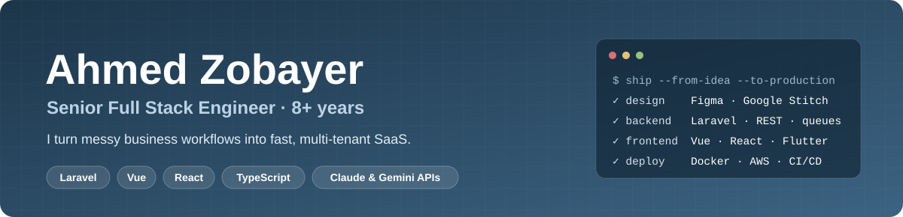
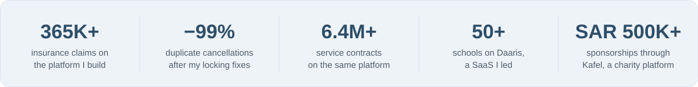
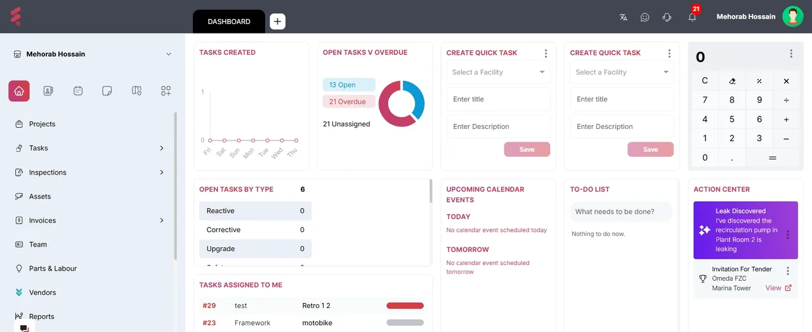
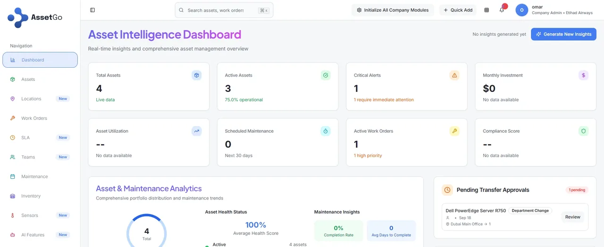
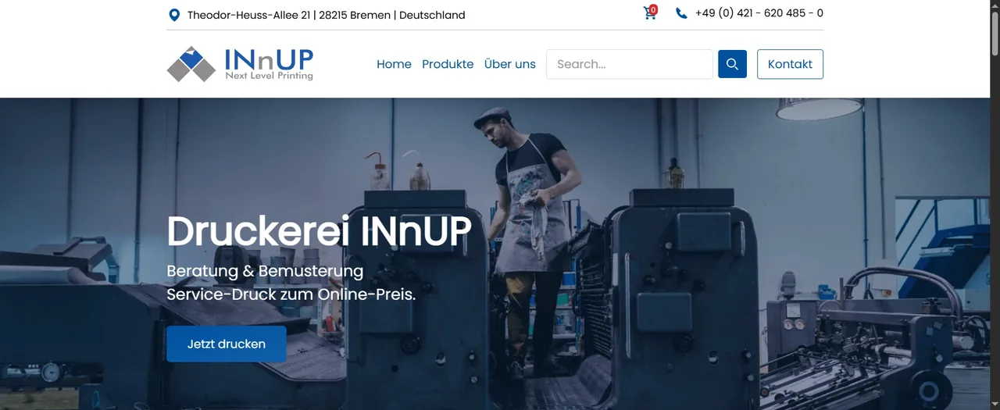
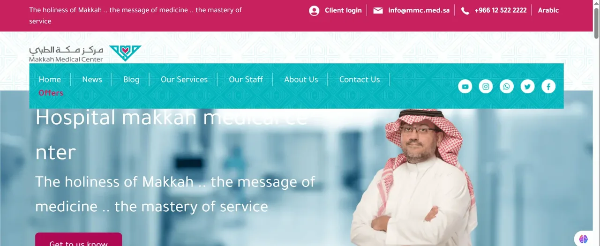

  

  
  
  
  

I'm a senior full stack engineer from Bangladesh, working remotely since 2019 with teams in the **US, Canada, UAE and Saudi Arabia**. I take products from the first Figma screen to production: Laravel APIs, Vue and React front ends, offline-first PWAs, CI/CD, and AI features built on Claude and Gemini.

  

## Featured work

<table>
  <tr>
    <td width="50%" valign="top">
      
      <h3>Equidesk</h3>
      AI-powered facility-management (CAFM) SaaS in the UAE. As senior developer I built its multi-tenant Laravel API, AI job creation, notifications and IoT sensor data.  
      <code>Laravel 10</code> <code>Sanctum</code> <code>AI</code> <code>IoT</code>
    </td>
    <td width="50%" valign="top">
      
      <h3>AssetGo</h3>
      Asset lifecycle management, live in production. I worked on its core architecture and system design, then built the Laravel API and Angular front end.  
      <code>Laravel 10</code> <code>Angular</code> <code>TypeScript</code> <code>Queues</code>
    </td>
  </tr>
  <tr>
    <td width="50%" valign="top">
      
      <h3>INnUP</h3>
      Server-rendered storefront for a German print shop: 200+ components, 169+ pages, live price calculation and multi-language support. Freelance.  
      <code>Nuxt 3</code> <code>Vue 3</code> <code>SSR</code> <code>SEO</code>
    </td>
    <td width="50%" valign="top">
      
      <h3>Makkah Medical Center</h3>
      Bilingual Arabic/English hospital website, admin panel and staff portal: departments, doctors, appointments and careers.  
      <code>Laravel 10</code> <code>Vue 3</code> <code>RTL</code> <code>i18n</code>
    </td>
  </tr>
</table>

## More I've shipped

| Project | What it is | Proof |
|---|---|---|
| **Nobilinx** | Vehicle-warranty claims platform (US). I built the claims workflow and the dealer APIs. | 365K+ claims · 12K+ dealers · duplicate cancellations down 99% |
| **Daaris** | Multi-school management SaaS (Saudi Arabia). I led development. | 50+ schools |
| **Kafel** | Charity sponsorship platform with sponsor and family portals. | SAR 500K+ processed |
| **United Assessments** | Bilingual assessments, surveys and circulars for establishments. I led development. | 10K+ submissions |
| **Saudagar** | Multi-tenant point-of-sale SaaS for shops, as an offline-first PWA. Lead developer. | Sells offline, syncs later |
| **DocDesk** | Practice-management SaaS for doctors: patient queue, visits and PDF prescriptions. | Multi-tenant, bilingual |

## Open source & side projects

- [**Encapsula**](https://github.com/shudhuiami/Encapsula): encrypts Laravel API responses with AES-256-GCM, with a TypeScript client for Vue, React, Next.js and Node.
- [**messenger-commerce-bot**](https://github.com/shudhuiami/messenger-commerce-bot): product Q&A and ordering inside Facebook Messenger, with an AI fallback.
- [**Panchforon**](https://github.com/shudhuiami/panchforon): turns a week of meals into one shopping list (Laravel API + React 19).
- [**WebJourney**](https://github.com/shudhuiami/WebJourney): step-by-step guides played on live websites (Chrome MV3 + SDK).
- Also: a Flutter fitness app with a local recipes database, and an AI resume builder (Claude & Gemini APIs).

## Tech stack

  

Plus Claude & Gemini APIs · Stripe · PayPal · bKash · Pusher · Horizon · PWA & IndexedDB · Playwright · Cypress

Open to senior full-stack roles · remote · any time zone · <a href="mailto:zobayer.me@gmail.com">zobayer.me@gmail.com</a>

